University: [ITMO University](https://itmo.ru/ru/)  
Faculty: [FICT](https://fict.itmo.ru)  
Course: [Vibe Coding: AI-боты для бизнеса](https://github.com/itmo-ict-faculty/vibe-coding-for-business)  
Year: 2026/2027  
Group: U4225  
Author: Presnyakova Anastasia Alekseevna  
Lab: Lab1  
Date of create: 11.10.2026  
Date of finished: 13.10.2026  

# Лабораторная работа №1. Создание первого Telegram-бота без программирования

**Цель работы:** научиться создавать работающего Telegram-бота для бизнес-задачи с помощью LLM, без ручного написания кода.

## 1. Описание задачи

### Какую проблему решает бот

Рабочие задачи поступают из разных источников: мессенджеры, встречи, электронная почта. При таком потоке часть задач теряется, сроки пропускаются. Бот Remindly собирает задачи в одном месте в Telegram, сортирует их по приоритету и сроку и присылает напоминания.

### Почему выбрана эта задача

Задача актуальна для любого пользователя. В лабораторной работе №3 требуется обратная связь от 3–5 пользователей, для такого бота их проще найти. Также, каждый пользователь работает только со своими задачами, бот не зависит от внешних сервисов.

### Создание бота

| Параметр | Значение |
|---|---|
| Название | Remindly |
| Username | @itmoftmi_paa_bot |

### Функционал бота

| Команда | Описание |
|---|---|
| `/start` | приветствие, включение ежедневной сводки |
| `/help` | список команд с примерами |
| `/add` | добавление задачи по шагам: текст, приоритет, срок |
| `/add <текст>` | то же, текст задачи указан сразу |
| текстовое сообщение | бот предлагает сохранить текст как задачу |
| `/list` | активные задачи: сначала просроченные, затем по приоритету и сроку |
| `/today` | задачи на сегодня и просроченные |
| `/done <номер>` | отметка о выполнении задачи |
| `/delete <номер>` | удаление задачи с подтверждением |
| `/remind <номер> <ЧЧ:ММ>` | напоминание сегодня, а если время прошло, то завтра |
| `/remind <номер> <ДД.ММ> <ЧЧ:ММ>` | напоминание в указанный день |
| `/remind`, `/done`, `/delete` без номера | выбор задачи кнопками, для `/remind` затем выбор варианта: через час, завтра, через неделю, в день срока, за сутки, неделю или месяц до срока, точное время |
| `/reminders` | задачи с установленными напоминаниями |
| `/digest` | статус ежедневной сводки |
| `/digest on`, `/digest off`, `/digest <ЧЧ:ММ>` | включение, выключение и время сводки |
| `/stats` | статистика по задачам |
| `/cancel` | выход из диалога |

На вопросы с кнопками можно ответить и текстом: «да» или «нет», приоритет, срок, вариант напоминания. Команды можно писать обычным текстом («список», «напоминания», «готово 3»). Опечатки распознаются с учётом раскладки клавиатуры. На приветствия бот отвечает как на `/start`. После добавления задачи бот предлагает поставить напоминание.

## 2. Промпт для LLM

Для генерации кода использовался Claude Code (Opus 5.5). Промпт составлен по шаблону из задания. В него добавлены список команд, формат ответов бота и структура хранимых данных, чтобы получить рабочую версию бота с первой попытки.

### Исходный промпт

```text
Создай Telegram-бота на Python с использованием библиотеки python-telegram-bot.
Бот Remindly: личный ассистент для задач. Язык интерфейса русский, часовой пояс Europe/Moscow.
Функционал бота:

1. Приём задач в текстовом виде

* /add запускает пошаговый диалог: текст задачи -> приоритет (inline-кнопки «🔴 Высокий», «🟡 Средний», «🟢 Низкий») -> срок (кнопки «Сегодня», «Завтра», «Без срока», «Указать дату»; дата вводится как ДД.ММ или ДД.ММ.ГГГГ).
* Быстрое добавление: если пользователь просто пишет текст вне диалога, бот предлагает сохранить его как задачу (кнопки «Добавить» и «Отмена») и дальше спрашивает приоритет и срок.
* Дату в прошлом бот принимает, но предупреждает, что задача сразу просрочена.
* /cancel прерывает любой диалог.
* Каждой задаче присваивается короткий номер (1, 2, 3...), уникальный для пользователя и не меняющийся после удаления других задач.

2. Организация по приоритетам и списки дел

* /list: все активные задачи. Порядок: просроченные, затем по приоритету от высокого к низкому, внутри приоритета по сроку. Строка: «#3 🔴 Подготовить отчёт · до 14.10», у просроченных пометка «⚠️ просрочено».
* /today: задачи со сроком на сегодня и просроченные.
* /done <номер>: отметить задачу выполненной.
* /delete <номер>: удалить задачу после подтверждения кнопками «Да» и «Нет».

3. Напоминания

* /remind <номер> <ЧЧ:ММ> или /remind <номер> <ДД.ММ> <ЧЧ:ММ>: напомнить о задаче в указанное время. Если указано только время и оно уже прошло, напомнить завтра.
* Сообщение-напоминание содержит кнопки «✅ Выполнено» и «⏰ Отложить на 1 час».
* Ежедневная сводка в 09:00: задачи на сегодня и просроченные. Включается автоматически после /start. /digest off выключает, /digest on включает, /digest 08:30 меняет время.
* После перезапуска бота все напоминания и сводки восстанавливаются из файла данных.

4. Статистика

* /stats: сколько задач всего, активных, выполненных, просроченных, и процент задач, выполненных в срок.

5. Служебные команды

* /start: приветствие и короткая инструкция из 3–4 строк.
* /help: список всех команд с примерами.
* При запуске бот регистрирует команды в меню Telegram (set_my_commands).
* На неизвестную команду бот предлагает /help.

Как бот должен отвечать:

* Коротко, дружелюбно, без лишнего текста.
* После каждого действия подтверждает результат, например: «Задача #3 добавлена: 🔴 высокий, срок 14.10».
* При ошибке ввода объясняет, что не так, и показывает пример, например: «Не понял время. Пример: /remind 3 18:30».

Какие данные хранить (файл tasks.json):

* Задачи каждого пользователя отдельно по user_id: номер, текст, приоритет, срок (дата или пусто), время напоминания, статус (активна или выполнена), дата создания, дата выполнения.
* Настройки пользователя: включена ли сводка и в какое время.
* Пользователь видит и меняет только свои задачи.

Требования:

* Бот должен быть простым и понятным
* Код должен быть хорошо прокомментирован
* Использовать файл для хранения данных (JSON или SQLite)
* Добавить обработку ошибок

Создай в папке lab1/bot:

1. Файл bot.py с кодом бота
2. Файл requirements.txt с зависимостями
3. Файл README.md с инструкцией по запуску
4. Файл .env.example для примера конфигурации

Токен я впишу в .env сама, не запрашивай его. После создания файлов проверь, что bot.py компилируется, и коротко перечисли, что сделано.
```

### Итерации и улучшения

После создания и запуска бота я начала тестировать функции. Найденные проблемы были исправлены уточняющими промптами.

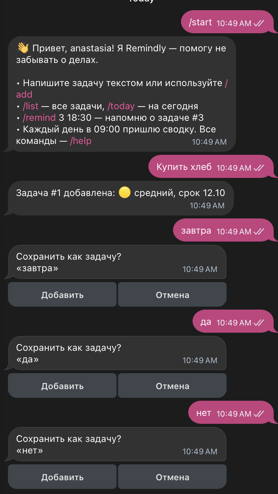

| № | Проблема | Уточняющий промпт | Результат |
|---|---|---|---|
| 1 | На вопрос «Сохранить как задачу?» нельзя ответить «да» или «нет» текстом: бот принимает ответ за новую задачу; после этого вопроса все команды блокируются до `/cancel`; дата без года всегда относится к текущему году | промпт 1 | ответы «да», «нет», «низкий» принимаются текстом; срок «01.01» сохранён как 01.01.2027; на нераспознанный ответ бот подсказывает варианты. |
| 2 | Команды работают только со слешем: «Лист» и «Напоминания» бот предлагает сохранить как задачи; ответ с опечаткой («завтр») не распознаётся | промпт 2 | «лист» и «напоминания» выполняются как команды; ответ «звтра» распознаётся как «завтра» (скриншоты 3, 4) |
| 3 | Опечатки распознавались без учёта клавиатуры; приветствие «Привет» бот предлагал сохранить как задачу | промпт 3 | на «Привет» бот отвечает приветствием; опечатки считаются с учётом соседних клавиш (скриншоты 3, 8) |
| 4 | `/remind` без номера не продолжал диалог: ответ «1 11:43» бот принимал за новую задачу; задачу нельзя выбрать кнопкой; напоминание задавалось только точным временем; после добавления задачи бот не предлагал напоминание | промпт 4 | `/remind` без номера показывает кнопки с задачами; после добавления задачи бот предлагает напоминание (скриншоты 5, 6) |
| 5 | При создании задачи показывались не все варианты напоминания; одинаковую задачу можно было создать повторно без предупреждения | промпт 5 | при создании задачи показываются все варианты напоминания; на повтор задачи бот спрашивает «Такая задача уже есть» (скриншоты 6, 9) |

**Промпт 1**

```text
Доработай бота:

1. Ответы текстом вместо кнопок
Сейчас на вопросы с кнопками можно ответить только кнопкой. Если написать «да» в ответ на «Сохранить как задачу?», бот принимает это за новую задачу и снова спрашивает: «Сохранить как задачу? «да»».
Нужно: на каждом шаге, где бот показывает кнопки, принимать и текстовый ответ, без учёта регистра, пробелов и точки в конце:
- «Сохранить как задачу?» и подтверждение /delete: «да», «ок», «добавить» означают «Да»; «нет», «отмена» означают «Нет»;
- приоритет: «высокий», «средний», «низкий»;
- срок: «сегодня», «завтра», «без срока» или сразу дата ДД.ММ или ДД.ММ.ГГГГ.
После текстового ответа кнопки в предыдущем сообщении убрать.
Если текст не распознан, бот подсказывает варианты, например: «Напишите: высокий, средний или низкий, либо нажмите кнопку».
Сообщения «да», «нет», «ок» вне диалога не предлагать сохранить как задачу. Бот отвечает: «Чтобы добавить задачу, напишите её текст».

2. Команды посреди диалога
Сейчас после вопроса «Сохранить как задачу?» все команды (/list, /help и др.) отвечают «Сейчас идёт добавление задачи…», пока не нажмёшь /cancel. Нужно: любая команда, кроме /add и /cancel, завершает диалог без лишних сообщений и выполняется как обычно. Таймаут диалога 10 минут.

3. Дата без года
Сейчас дата без года всегда считается датой текущего года: 20 декабря срок «10.01» сразу становится просроченным. Нужно: для даты без года выбирать ближайшую к сегодняшнему дню, в этом или следующем году. Правило действует и для срока задачи, и для /remind.

После изменений проверь, что bot.py компилируется, и коротко опиши, что изменил.
```

Результат промпта 1:

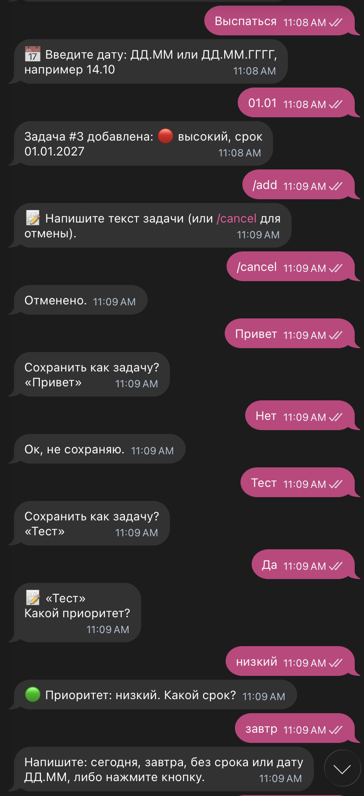

**Промпт 2**

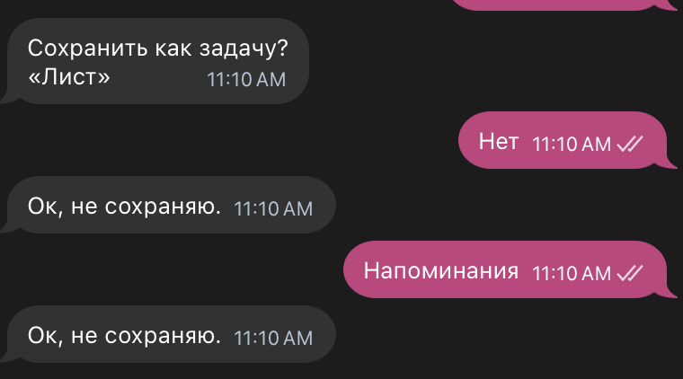

```text
Доработай бота:

1. Команды обычным текстом
Сейчас команды работают только со слешем. Если написать «Лист» или «Напоминания», бот предлагает сохранить это как задачу.
Нужно: понимать команды, написанные обычным текстом, без учёта регистра:
- «список», «лист», «задачи», «мои задачи» → /list
- «сегодня», «на сегодня» → /today
- «напоминания» → новая команда /reminders: задачи с установленными напоминаниями и временем напоминания
- «статистика» → /stats
- «помощь», «команды» → /help
- «сводка», «сводка вкл», «сводка выкл», «сводка 08:30» → /digest, /digest on, /digest off, /digest 08:30
- «добавить» или «добавить <текст>» → /add
- «готово 3», «выполнено 3», «сделано 3» → /done 3
- «удалить 3» → /delete 3
- «напомни 3 18:30», «напомни 3 14.10 18:30» → /remind
- «отмена» → /cancel
Текст считается командой, только если всё сообщение совпадает с одним из вариантов. «Список покупок» или «Сегодня позвонить маме» остаются задачами и идут в быстрое добавление.
Посреди диалога сначала проверяется ответ на текущий вопрос: например, «сегодня» на шаге срока выбирает срок. Текстовая команда посреди диалога работает так же, как команда со слешем: диалог завершается, команда выполняется.

2. Опечатки
Сейчас «завтр» или «звтра» бот не понимает. Нужно: распознавать ответы на вопросы и текстовые команды с небольшими опечатками, например «звтра» → «завтра», «срдений» → «средний», «спсок» → «список». Для коротких слов («да», «нет», «ок») только точное совпадение. Используй стандартный модуль difflib, без новых зависимостей. Переспрашивать не нужно: исправленное значение видно в подтверждении, например «срок 13.10».

Обнови /help и README.md: перечисли текстовые варианты команд. Добавь /reminders в меню команд (set_my_commands).
После изменений проверь, что bot.py компилируется, и коротко опиши, что изменил.
```

**Промпт 3**


```text
Доработай бота:

1. Опечатки с учётом клавиатуры
Сейчас опечатки распознаются без учёта того, где стоят клавиши. Нужно считать опечатки по раскладке ЙЦУКЕН:
- одной опечаткой считаются пропущенная или лишняя буква («звтра»), две соседние буквы, переставленные местами («срдений»), и нажатие соседней клавиши («зпвтра»: «п» стоит рядом с «а»);
- буква, заменённая на далёкую клавишу, считается двумя опечатками, чтобы похожие слова не путались («помочь» и «помощь»: «ч» и «щ» на клавиатуре далеко);
- в словах до 4 букв («да», «нет», «ок», «лист») опечатки не допускаются, в словах из 5–7 букв допускается одна, в более длинных две;
- если текст одинаково похож на два разных варианта, бот показывает подсказку с вариантами.
Правила действуют и для ответов на вопросы, и для текстовых команд. Без новых зависимостей.

2. Приветствия
Сейчас на «Привет» бот отвечает «Сохранить как задачу? «Привет»». Нужно: если сообщение целиком состоит из приветствия («привет», «здравствуйте», «добрый день», «доброе утро», «добрый вечер», «hi», «hello» и подобные), бот отвечает так же, как на /start. Опечатки в приветствиях распознаются по тем же правилам. «Привет, купить молоко» остаётся задачей.

После изменений проверь, что bot.py компилируется, и коротко опиши, что изменил.
```

Что изменилось в коде после промпта 3:

- опечатки считаются по раскладке ЙЦУКЕН: пропущенная или лишняя буква, перестановка соседних букв и нажатие соседней клавиши считаются одной опечаткой, замена на далёкую клавишу считается двумя;
- в словах до 4 букв («да», «нет», «лист») опечатки не допускаются, в словах до 7 букв допускается одна, в более длинных две;
- приветствия («привет», «здравствуйте», «добрый день» и другие) бот не предлагает сохранить как задачу и отвечает так же, как на `/start`.

**Промпт 4**

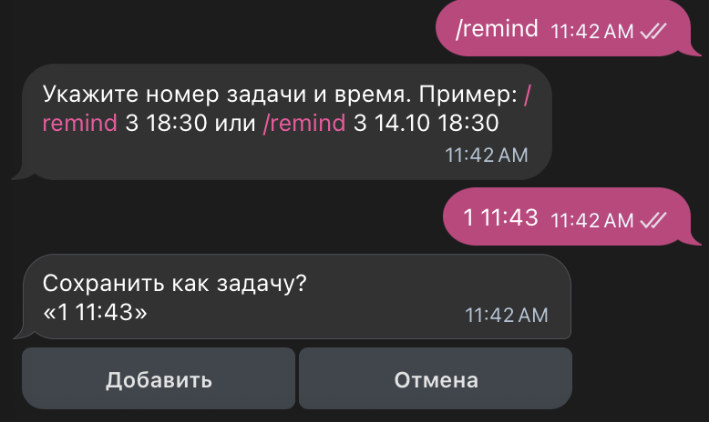

```text
Доработай бота:

1. Выбор задачи кнопками
Сейчас /remind без номера отвечает подсказкой, а следующее сообщение «1 11:43» бот принимает за новую задачу.
Нужно: если /remind, /done или /delete отправлены без номера (в том числе текстом: «напомни», «готово», «удалить»), бот показывает кнопки с активными задачами. На кнопке номер и начало текста задачи до 30 символов, например «#1 Купить хлеб» или «#4 Подготовить отчёт по лаб…». Порядок как в /list, не больше 10 кнопок. Вместо кнопки можно написать номер задачи, а для /remind сразу номер и время («1 11:43»): бот принимает это как продолжение команды.

2. Варианты напоминания
После выбора задачи в /remind бот предлагает варианты кнопками:
- если у задачи есть срок: «В день срока», «За сутки», «За неделю», «За месяц». Напоминание приходит в 10:00 выбранного дня: «за сутки» накануне срока, «за неделю» за 7 дней, «за месяц» в то же число предыдущего месяца (если такого числа нет, в последний день месяца). Варианты, время которых уже прошло, не показывать;
- если срока нет: «Через час», «Завтра в 10:00», «Через неделю»;
- всегда: «Указать время» (ЧЧ:ММ или ДД.ММ ЧЧ:ММ) и «Не напоминать».
Варианты можно написать текстом, опечатки распознаются по тем же правилам, что и в остальных ответах.
Подтверждение, например: «⏰ Напомню 13.10 в 10:00 (за сутки до срока)». В /reminders показывать выбранный вариант.
Старая форма /remind 3 18:30 и /remind 3 14.10 18:30 работает как раньше.

3. Напоминание при добавлении задачи
После сохранения новой задачи бот спрашивает «Напомнить о задаче?» и показывает те же варианты, что в п. 2. «Не напоминать» завершает диалог. Если вместо ответа пользователь пишет новую задачу или команду, вопрос молча закрывается и новое сообщение обрабатывается как обычно.

У задачи одно напоминание: новое заменяет старое. Напоминания восстанавливаются после перезапуска, как сейчас.
Обнови /help и README.md. После изменений проверь, что bot.py компилируется, и коротко опиши, что изменил.
```

**Промпт 5**

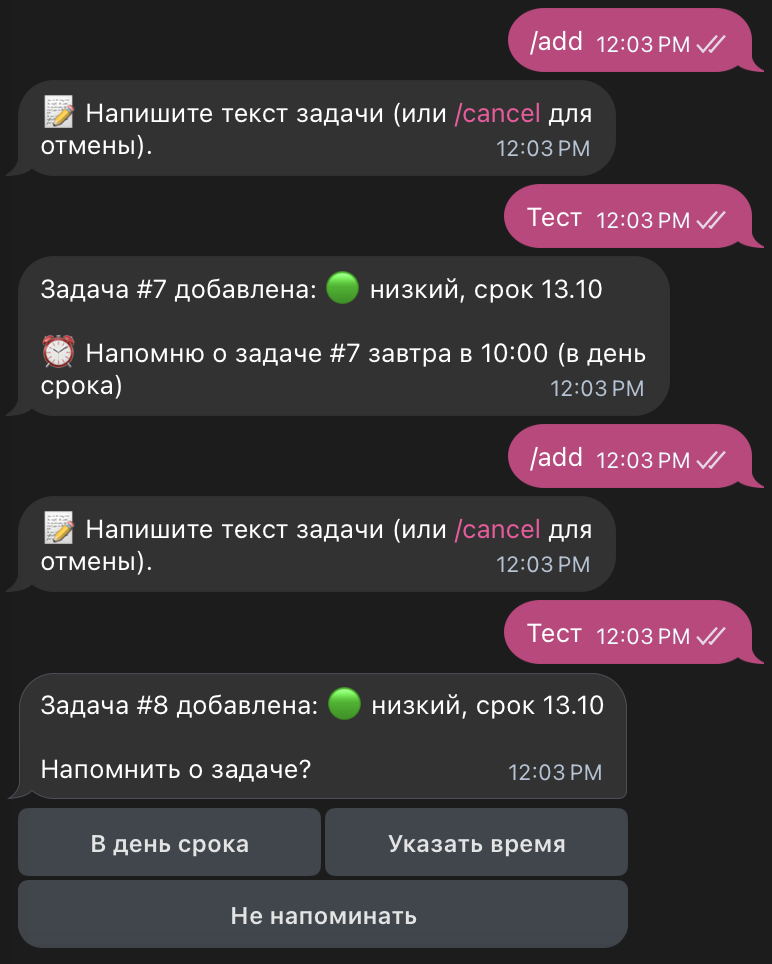

```text
Доработай бота:

1. Все варианты напоминания
Сейчас при создании задачи со сроком на завтра бот показывает только «В день срока», «Указать время» и «Не напоминать»: остальные варианты скрыты, потому что их время уже прошло.
Нужно: всегда показывать полный набор кнопок, и при создании задачи, и в /remind:
- по времени: «Через час», «Завтра в 10:00», «Через неделю»;
- если у задачи есть срок, дополнительно: «В день срока», «За сутки до срока», «За неделю до срока», «За месяц до срока»;
- «Указать время» и «Не напоминать».
Кнопки располагать по две в ряд, «Не напоминать» отдельной строкой внизу.
Если выбран вариант, время которого уже прошло, бот оставляет кнопки и пишет, например: «Время для варианта «За неделю до срока» уже прошло (06.10 в 10:00). Выберите другой вариант». Текстовые ответы и опечатки работают для всех вариантов, в том числе короткие названия «за сутки», «за неделю», «за месяц».

2. Повторяющиеся задачи
Если пользователь добавляет задачу с тем же текстом, что у одной из активных задач (без учёта регистра, лишних пробелов и знаков препинания в конце), бот сразу после ввода текста спрашивает: «Такая задача уже есть: #7 🟢 Тест · до 13.10. Всё равно создать?» с кнопками «Создать» и «Отмена». Ответить можно и текстом («да», «нет»). «Отмена» завершает диалог с сообщением «Ок, не создаю». Проверка работает для /add, /add <текст> и быстрого добавления; при быстром добавлении этот вопрос заменяет «Сохранить как задачу?». С выполненными задачами текст не сравнивать.

Обнови /help и README.md, если изменились названия вариантов. После изменений проверь, что bot.py компилируется, и коротко опиши, что изменил.
```

### Финальный промпт

Исходный промпт с учётом итераций 1–5, объединённый в один текст.

```text
Создай Telegram-бота на Python с использованием библиотеки python-telegram-bot.
Бот Remindly: личный ассистент для задач. Язык интерфейса русский, часовой пояс Europe/Moscow.
Функционал бота:

1. Приём задач в текстовом виде

* /add запускает пошаговый диалог: текст задачи -> приоритет (inline-кнопки «🔴 Высокий», «🟡 Средний», «🟢 Низкий») -> срок (кнопки «Сегодня», «Завтра», «Без срока», «Указать дату»; дата вводится как ДД.ММ или ДД.ММ.ГГГГ) -> напоминание (см. п. 3).
* Быстрое добавление: если пользователь просто пишет текст вне диалога, бот предлагает сохранить его как задачу (кнопки «Добавить» и «Отмена») и дальше спрашивает приоритет, срок и напоминание.
* Приветствия («привет», «здравствуйте», «добрый день», «hi» и подобные) бот не предлагает сохранить как задачу и отвечает так же, как на /start. «Привет, купить молоко» остаётся задачей.
* Для даты без года выбирается ближайшая к сегодняшнему дню, в этом или следующем году. Дату в прошлом бот принимает, но предупреждает, что задача сразу просрочена.
* /cancel прерывает любой диалог. Любая другая команда посреди диалога завершает его без лишних сообщений и выполняется как обычно. Таймаут диалога 10 минут.
* Если текст новой задачи совпадает с текстом одной из активных задач (без учёта регистра, лишних пробелов и знаков препинания в конце), бот сразу после ввода текста спрашивает: «Такая задача уже есть: #7 🟢 Тест · до 13.10. Всё равно создать?» с кнопками «Создать» и «Отмена». При быстром добавлении этот вопрос заменяет «Сохранить как задачу?».
* Каждой задаче присваивается короткий номер (1, 2, 3...), уникальный для пользователя и не меняющийся после удаления других задач.

2. Организация по приоритетам и списки дел

* /list: все активные задачи. Порядок: просроченные, затем по приоритету от высокого к низкому, внутри приоритета по сроку. Строка: «#3 🔴 Подготовить отчёт · до 14.10», у просроченных пометка «⚠️ просрочено».
* /today: задачи со сроком на сегодня и просроченные.
* /done <номер>: отметить задачу выполненной.
* /delete <номер>: удалить задачу после подтверждения кнопками «Да» и «Нет».
* Если /done, /delete или /remind отправлены без номера, бот показывает кнопки с активными задачами: номер и начало текста до 30 символов, например «#1 Купить хлеб». Порядок как в /list, не больше 10 кнопок. Вместо кнопки можно написать номер, а для /remind сразу номер и время («1 11:43»).

3. Напоминания

* /remind <номер> <ЧЧ:ММ> или /remind <номер> <ДД.ММ> <ЧЧ:ММ>: напомнить о задаче в указанное время. Если указано только время и оно уже прошло, напомнить завтра.
* /remind без времени показывает варианты кнопками, по две в ряд: «Через час», «Завтра в 10:00», «Через неделю»; если у задачи есть срок, дополнительно «В день срока», «За сутки до срока», «За неделю до срока», «За месяц до срока» (напоминание в 10:00 выбранного дня; «за месяц» означает то же число предыдущего месяца, а если такого числа нет, последний день месяца); «Указать время» (ЧЧ:ММ или ДД.ММ ЧЧ:ММ); отдельной строкой «Не напоминать». Кнопки показываются всегда. Если время выбранного варианта уже прошло, бот оставляет кнопки и пишет: «Время для варианта «За неделю до срока» уже прошло (06.10 в 10:00). Выберите другой вариант».
* После сохранения новой задачи бот спрашивает «Напомнить о задаче?» с теми же вариантами. Если вместо ответа пользователь пишет новую задачу или команду, вопрос молча закрывается.
* Подтверждение, например: «⏰ Напомню 13.10 в 10:00 (за сутки до срока)».
* У задачи одно напоминание: новое заменяет старое.
* /reminders: задачи с установленными напоминаниями, временем и выбранным вариантом.
* Сообщение-напоминание содержит кнопки «✅ Выполнено» и «⏰ Отложить на 1 час».
* Ежедневная сводка в 09:00: задачи на сегодня и просроченные. Включается автоматически после /start. /digest off выключает, /digest on включает, /digest 08:30 меняет время.
* После перезапуска бота все напоминания и сводки восстанавливаются из файла данных.

4. Статистика

* /stats: сколько задач всего, активных, выполненных, просроченных, и процент задач, выполненных в срок.

5. Служебные команды

* /start: приветствие и короткая инструкция из 3–4 строк.
* /help: список всех команд с примерами, включая текстовые варианты.
* При запуске бот регистрирует команды в меню Telegram (set_my_commands).
* На неизвестную команду бот предлагает /help.

6. Ввод обычным текстом

* На любой вопрос с кнопками можно ответить текстом, без учёта регистра, пробелов и знаков препинания в конце: «да», «ок», «добавить» означают «Да»; «нет», «отмена» означают «Нет»; приоритет: «высокий», «средний», «низкий»; срок: «сегодня», «завтра», «без срока» или дата; варианты напоминания по их названиям. После текстового ответа кнопки в предыдущем сообщении убираются. Если ответ не распознан, бот подсказывает варианты.
* Сообщения «да», «нет», «ок» вне диалога бот не предлагает сохранить как задачу и отвечает: «Чтобы добавить задачу, напишите её текст».
* Команды можно писать обычным текстом, если всё сообщение совпадает с вариантом: «список», «лист», «задачи», «мои задачи» -> /list; «сегодня», «на сегодня» -> /today; «напоминания» -> /reminders; «статистика» -> /stats; «помощь», «команды» -> /help; «сводка», «сводка вкл», «сводка выкл», «сводка 08:30» -> /digest; «добавить» или «добавить <текст>» -> /add; «готово 3», «выполнено 3», «сделано 3» -> /done 3; «удалить 3» -> /delete 3; «напомни 3 18:30» -> /remind; «отмена» -> /cancel. «Список покупок» остаётся задачей. Посреди диалога сначала проверяется ответ на текущий вопрос.
* Опечатки распознаются по раскладке ЙЦУКЕН: пропущенная или лишняя буква, две соседние буквы, переставленные местами, и нажатие соседней клавиши считаются одной опечаткой; замена на далёкую клавишу считается двумя. В словах до 4 букв опечатки не допускаются, в словах из 5–7 букв допускается одна, в более длинных две. Если текст одинаково похож на два варианта, бот показывает подсказку. Без новых зависимостей.

Как бот должен отвечать:

* Коротко, дружелюбно, без лишнего текста.
* После каждого действия подтверждает результат, например: «Задача #3 добавлена: 🔴 высокий, срок 14.10».
* При ошибке ввода объясняет, что не так, и показывает пример, например: «Не понял время. Пример: /remind 3 18:30».

Какие данные хранить (файл tasks.json):

* Задачи каждого пользователя отдельно по user_id: номер, текст, приоритет, срок (дата или пусто), время и вариант напоминания, статус (активна или выполнена), дата создания, дата выполнения.
* Настройки пользователя: включена ли сводка и в какое время.
* Пользователь видит и меняет только свои задачи.

Требования:

* Бот должен быть простым и понятным
* Код должен быть хорошо прокомментирован
* Использовать файл для хранения данных (JSON или SQLite)
* Добавить обработку ошибок

Создай в папке lab1/bot:

1. Файл bot.py с кодом бота
2. Файл requirements.txt с зависимостями
3. Файл README.md с инструкцией по запуску
4. Файл .env.example для примера конфигурации

Токен я впишу в .env сама, не запрашивай его. После создания файлов проверь, что bot.py компилируется (python -m py_compile bot.py), и коротко перечисли, что сделано.
```

## 3. Стек технологий

| Компонент | Назначение | Причина выбора |
|---|---|---|
| Python 3.12.9 | язык разработки | рекомендован курсом, наиболее распространённый язык для разработки Telegram-ботов |
| python-telegram-bot 22.8 с дополнением job-queue | работа с Telegram Bot API | рекомендована в задании; содержит встроенный планировщик JobQueue, через который реализованы напоминания и ежедневная сводка |
| python-dotenv 1.2.4 | загрузка токена из файла `.env` | токен хранится отдельно от кода и не попадает в репозиторий |
| tzdata 2026.5 | база часовых поясов | нужна для работы часового пояса Europe/Moscow на системах без встроенной базы, например Windows |
| JSON (`tasks.json`) | хранение задач и настроек пользователей | простой формат, содержимое файла можно проверить вручную; для первой версии бота отдельная СУБД не требуется |
| Claude Code | генерация и исправление кода | работает в папке проекта: создаёт файлы, выполняет проверки, исправляет ошибки по описанию |
| BotFather | регистрация бота и получение токена | инструмент Telegram для создания ботов |

## 4. Запуск бота

Подробная инструкция: [lab1/bot/README.md](bot/README.md).

```bash
cd lab1/bot
python3 -m venv .venv
source .venv/bin/activate
pip install -r requirements.txt
cp .env.example .env
python bot.py
```

Остановка бота: `Ctrl + C` в Терминале.

## 5. Скриншоты и видео

### Скриншоты работы бота

1. Запуск бота: `/start`  
   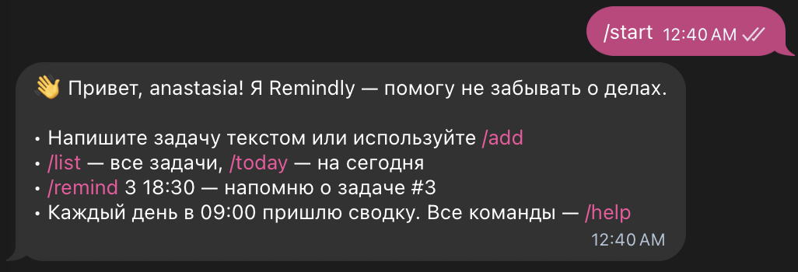
2. Добавление задачи через `/add`  
   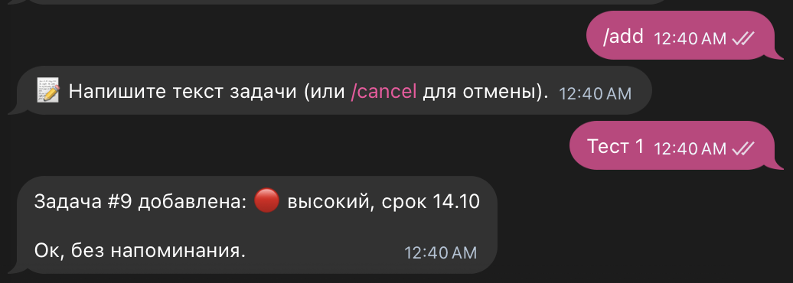
3. Быстрое добавление задачи текстом: ответ «да» и приоритет с опечаткой «низкй»  
   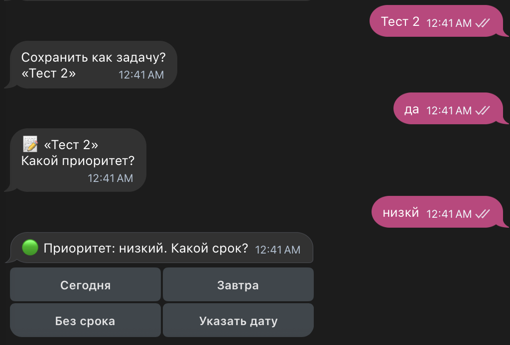
4. Список задач по командам «список» и «лист», просроченная задача отмечена  
   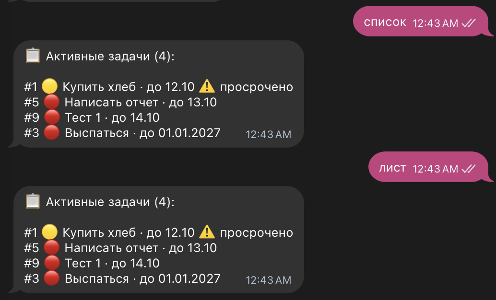
5. `/remind` без номера: выбор задачи кнопками  
   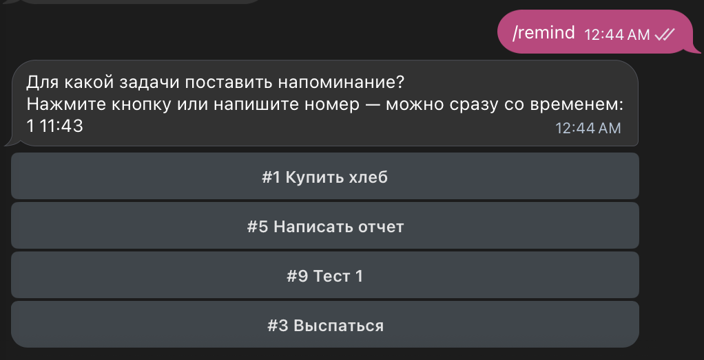
6. Варианты напоминания для задачи со сроком  
   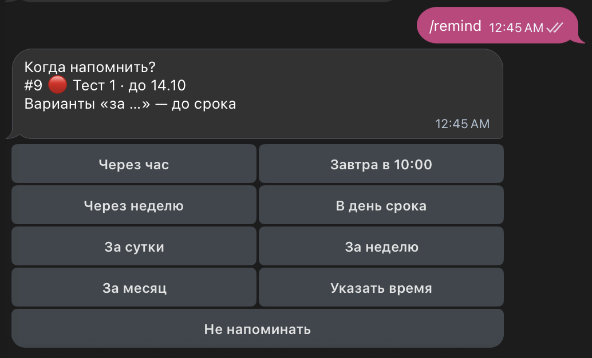
7. Пришедшее напоминание с кнопками «Выполнено» и «Отложить на 1 час»  
   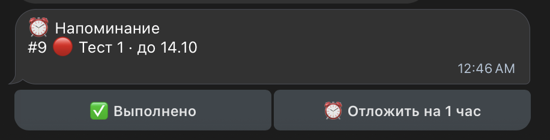
8. Ответ на приветствие  
   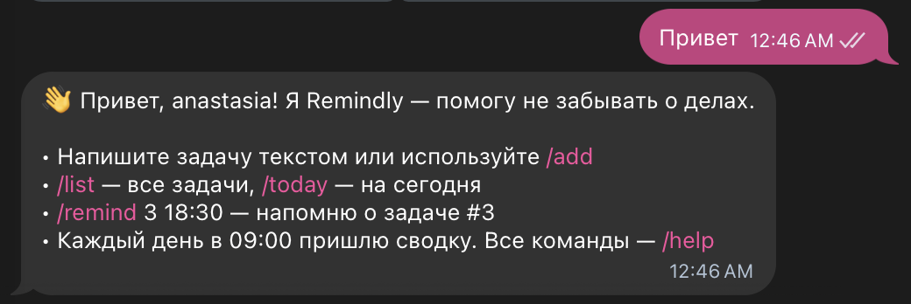
9. Предупреждение о повторяющейся задаче  
   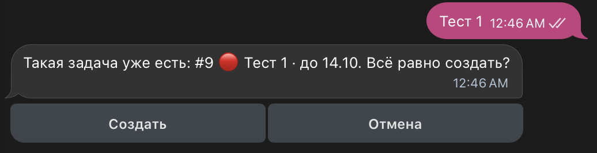
10. Статистика `/stats`  
    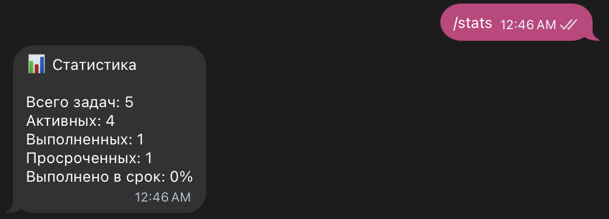

### Видео-демо

Ссылка: []  

## 6. Трудности и решения

| Проблема | Причина | Решение |
|---|---|---|
| Ответ «да» на вопрос «Сохранить как задачу?» бот принимал за новую задачу | на вопросы с кнопками бот принимал только нажатие кнопки, любой текст запускал быстрое добавление | итерация 1, п. 1: текстовые ответы на всех шагах с кнопками |
| После вопроса «Сохранить как задачу?» команды не выполнялись до `/cancel` | быстрое добавление запускает диалог, а в диалоге все команды перехватывает обработчик «идёт добавление задачи» | итерация 1, п. 2: команды завершают диалог, добавлен таймаут 10 минут |
| Срок «10.01», введённый в декабре, считался бы просроченным | дата без года всегда относилась к текущему году | итерация 1, п. 3: выбирается ближайшая дата |
| Бот не запускался, ошибка `InvalidToken` | файл `.env` перезаписан примером из `.env.example` | в `.env` заново вписан токен из @BotFather |
| «Лист» и «Напоминания» бот предлагал сохранить как задачи, ответ «завтр» не распознавался | команды работали только со слешем, ответы сравнивались только точно | итерация 2: текстовые команды и распознавание опечаток |
| После `/remind` без номера ответ «1 11:43» бот принимал за новую задачу | команда без аргументов только показывала подсказку и не ждала продолжения | итерация 4: выбор задачи кнопками и продолжение команды текстом |
| Одинаковую задачу можно было создать повторно | бот не сравнивал текст новой задачи с существующими | итерация 5: предупреждение «Такая задача уже есть» |

## 7. Выводы

### Что получилось хорошо

- Бот выполняет все функции из исходного промпта и доработки из пяти итераций.
- Бот понимает обычный текст: ответы вместо кнопок, команды без слеша, опечатки с учётом раскладки клавиатуры.
- Напоминание можно поставить относительно срока задачи: в день срока, за сутки, неделю или месяц.
- Данные сохраняются надёжно: запись в `tasks.json` идёт через временный файл, повреждённый файл сохраняется как `tasks.broken.json`, бот продолжает работу.
- После перезапуска бот восстанавливает напоминания и ежедневные сводки.
- Кнопки из старых сообщений не ломают бота: он сообщает, что кнопка устарела.

### Что можно улучшить

- Разрешить несколько напоминаний для одной задачи, сейчас новое напоминание заменяет старое.
- Распознавать текст, набранный в английской раскладке, например «cgbcjr» вместо «список».
- Добавить возможность создавать группы задач, например, группа «Бытовые» для «Купить хлеб».

### Чему научилась

- Формулировать требования к боту в промпте.
- Проверять результат в Telegram и описывать ошибку так, чтобы LLM могла её исправить.
- Дорабатывать бота итерациями.
- Хранить токен бота в файле `.env` и не публиковать его.
