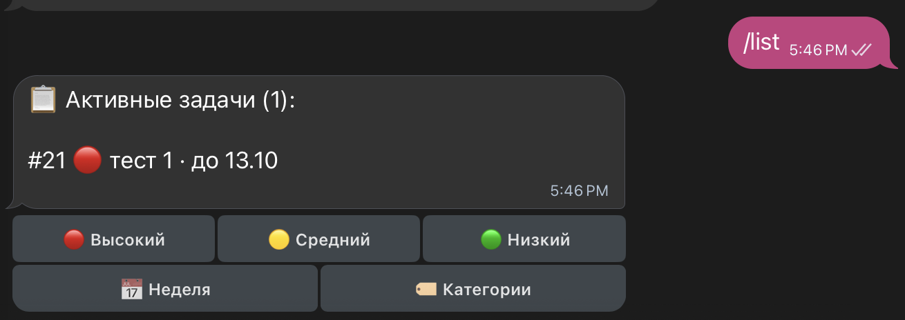
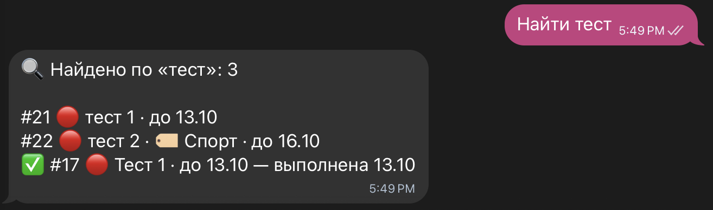
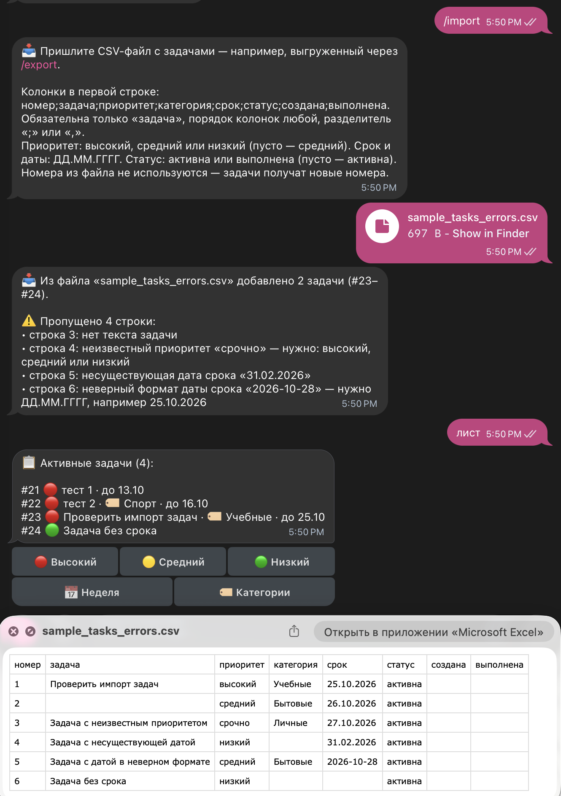
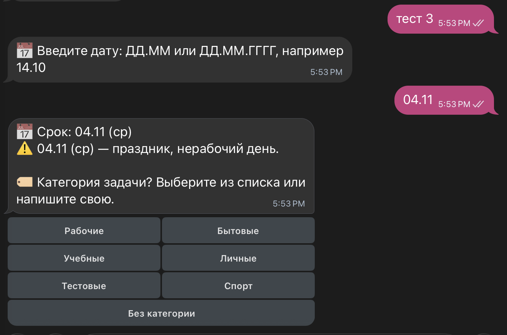
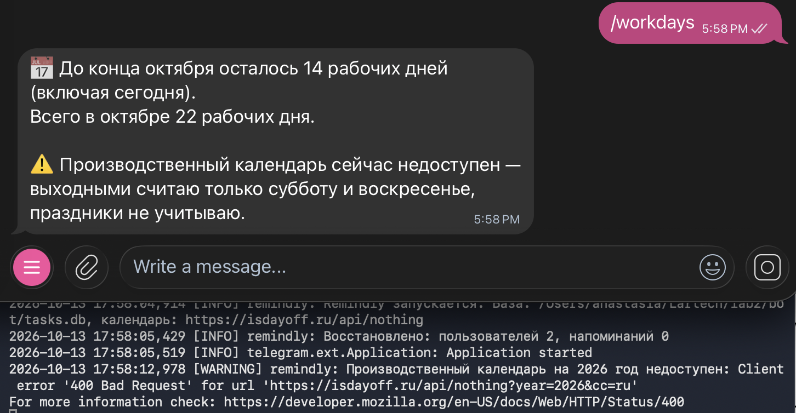
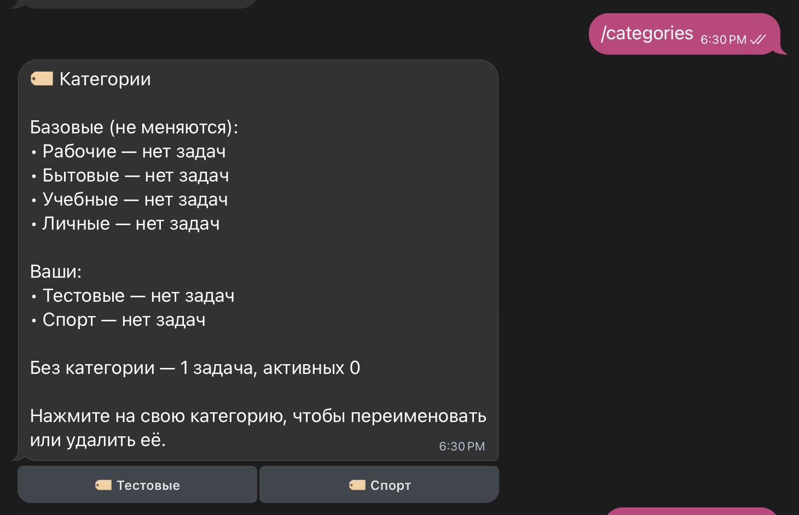

University: [ITMO University](https://itmo.ru/ru/)  
Faculty: [FICT](https://fict.itmo.ru)  
Course: [Vibe Coding: AI-боты для бизнеса](https://github.com/itmo-ict-faculty/vibe-coding-for-business)  
Year: 2026/2027  
Group: U4225  
Author: Presnyakova Anastasia Alekseevna  
Lab: Lab2  
Date of create: 13.10.2026  
Date of finished: 13.10.2026  

# Лабораторная работа №2. Подключение бота к данным

**Цель работы:** подключить Telegram-бота к внешним источникам данных и организовать работу с ними через код, сгенерированный LLM.

## 1. Источники данных

Бот Remindly из лабораторной работы №1 подключён к трём источникам данных.

| Источник | Тип | Что даёт пользователю |
|---|---|---|
| SQLite (`tasks.db`) | база данных | хранение задач, категории, поиск по тексту, история выполненных задач, фильтры |
| CSV-файлы | файлы | выгрузка задач в Excel и загрузка списка задач из файла |
| [isdayoff.ru](https://isdayoff.ru) | публичный API | производственный календарь РФ: срок "через N рабочих дней", предупреждение о сроке на выходной или праздник, сводка только в рабочие дни |

### Почему выбраны эти источники

1. **SQLite.** JSON-файл перезаписывается целиком при каждом изменении, и по нему неудобно искать. SQLite хранит данные в одном файле, не требует отдельного сервера и поддерживает запросы с фильтрами. Модуль `sqlite3` входит в стандартную библиотеку Python.
2. **CSV.** Задачи часто ведутся в Excel. Экспорт позволяет передать список, например, коллегам или близким, импорт позволяет перенести задачи из таблицы в бот за один шаг.
3. **isdayoff.ru.** Рабочие сроки считаются в рабочих днях. API бесплатный, работает без ключа и учитывает российские праздники.

## 2. Промпт для LLM

Для генерации кода использовался Claude Code (Opus 5.5). Промпт составлен по шаблону из задания: описан текущий функционал бота, новый функционал по каждому источнику данных и требования к обработке ошибок и сохранению существующих функций. Для импорта подготовлен пример файла [`data/sample_tasks.csv`](data/sample_tasks.csv).

### Исходный промпт

```text
Улучши моего Telegram-бота Remindly в папке lab2/bot (это копия бота из lab1). Всё, что бот уже умеет, должно работать как раньше.

Что бот умеет сейчас:
- добавлять задачи с приоритетом и сроком, показывать список, отмечать выполненные и удалять;
- ставить напоминания и присылать утреннюю сводку;
- понимать команды и ответы обычным текстом, даже с опечатками;
- задачи хранятся в файле tasks.json.

Что нужно добавить:

1. База данных
Хранить задачи в SQLite вместо tasks.json. Мои задачи из tasks.json должны перенестись в базу автоматически при первом запуске.

2. Категории задач
- после выбора срока бот спрашивает категорию: "Выберите из списка или напишите свою". В списке базовые категории ("Рабочие", "Бытовые", "Учебные", "Личные"), категории, которые я создала сама, и кнопка "Без категории";
- новая категория, написанная текстом, сохраняется и дальше появляется в списке;
- категория видна в списке задач.

3. Поиск и история
- /find <слово>: найти задачи по слову;
- /history: последние выполненные задачи;
- в /list фильтры: по приоритету, по категории и задачи на ближайшую неделю.

4. Выгрузка и загрузка задач
- /export: бот присылает файл со всеми моими задачами, который открывается в Excel;
- /import: я отправляю файл, бот добавляет задачи из него. Формат как в примере lab2/data/sample_tasks.csv. Если в каких-то строках ошибки, бот пишет, какие строки пропустил и почему.

5. Производственный календарь (бесплатный API isdayoff.ru)
- при выборе срока можно выбрать "через N рабочих дней", бот считает дату с учётом выходных и праздников;
- если срок выпадает на выходной или праздник, бот предупреждает;
- /workdays: сколько рабочих дней осталось до конца месяца;
- если календарь недоступен, бот не ломается, учитывает только субботу и воскресенье и сообщает об этом. Адрес календаря вынеси в .env, чтобы я могла это проверить.

6. Новые команды тоже можно писать обычным текстом: "найти отчёт", "история", "экспорт", "импорт", "рабочие дни", "список рабочие".

Требования:
- Сохранить существующий функционал
- Код должен быть простым и хорошо прокомментированным
- Добавить обработку ошибок
- Обновить /help и README.md

Обнови в папке lab2/bot: bot.py, requirements.txt, README.md, .env.example.
```

### Итерации и улучшения

| № | Что изменено | Причина | Результат |
|---|---|---|---|
| 1 | редактирование задач, сводка только в рабочие дни, очистка истории | задачу нельзя было изменить без удаления; сводка приходила и в выходные; история выполненных задач только росла | появились выбор задачи для редактирования, переключатель режима сводки и кнопки очистки истории (скриншоты 5, 12, 13) |
| 2 | управление категориями | свои категории нельзя было переименовать или удалить | появилась команда `/categories`: список категорий с числом задач, свои категории можно переименовать и удалить; при переименовании категория меняется во всех задачах, при удалении задачи переходят в "Без категории" (скриншоты 14, 15) |

**Промпт 1**

```text
Добавь в бота три возможности, остальной функционал не меняй.

1. Редактирование задач
- /edit <номер>: бот показывает задачу и спрашивает, что изменить: кнопки "Текст", "Приоритет", "Срок", "Категория". Дальше те же шаги, что при добавлении задачи.
- /edit без номера: бот показывает кнопки с задачами, как в /remind.
- Текстом это можно сделать так: "изменить 3" или "редактировать 3".
- После изменения бот показывает обновлённую задачу, например: "Задача #3 изменена: 🔴 Подготовить отчёт · до 14.10 · Рабочие".
- Если у задачи стояло напоминание относительно срока (например, "за сутки до срока"), после смены срока напоминание переносится на новую дату.

2. Сводка только в рабочие дни
- В /digest бот показывает текущие настройки и кнопки "Каждый день" и "Только в рабочие дни".
- В режиме "Только в рабочие дни" сводка не приходит в выходные и праздники по производственному календарю.
- Если календарь недоступен, нерабочими считаются только суббота и воскресенье.
- Текстом это можно сделать так: "сводка рабочие" и "сводка каждый день".
- По умолчанию сводка приходит каждый день, как сейчас.

3. Очистка истории
- Под списком /history кнопки "Очистить всё" и "Старше 30 дней". Перед удалением бот спрашивает подтверждение кнопками "Да" и "Нет", ответить можно и текстом.
- Текстом это можно сделать так: "очистить историю".
- Задачи пропадают из /history и /find, но /stats продолжает их учитывать, чтобы статистика не обнулялась.

Обнови /help и README.md.
```

**Промпт 2**

```text
Добавь в бота управление категориями, остальной функционал не меняй.
- /categories: бот показывает базовые категории и категории, которые я создала сама, и сколько задач в каждой.
- Свои категории можно переименовать и удалить кнопками. Базовые категории ("Рабочие", "Бытовые", "Учебные", "Личные") не меняются.
- При переименовании категория меняется во всех задачах.
- Перед удалением бот спрашивает подтверждение и пишет, сколько задач в этой категории. После удаления эти задачи переходят в "Без категории".
- Текстом это можно сделать так: "категории".
- Обнови /help и README.md.
```

### Финальный промпт

```text
Улучши моего Telegram-бота Remindly в папке lab2/bot (это копия бота из lab1). Всё, что бот уже умеет, должно работать как раньше.

Что бот умеет сейчас:
- добавлять задачи с приоритетом и сроком, показывать список, отмечать выполненные и удалять;
- ставить напоминания и присылать утреннюю сводку;
- понимать команды и ответы обычным текстом, даже с опечатками;
- задачи хранятся в файле tasks.json.

Что нужно добавить:

1. База данных
Хранить задачи в SQLite вместо tasks.json. Мои задачи из tasks.json должны перенестись в базу автоматически при первом запуске.

2. Категории задач
- после выбора срока бот спрашивает категорию: "Выберите из списка или напишите свою". В списке базовые категории ("Рабочие", "Бытовые", "Учебные", "Личные"), категории, которые я создала сама, и кнопка "Без категории";
- новая категория, написанная текстом, сохраняется и дальше появляется в списке;
- категория видна в списке задач.

3. Поиск и история
- /find <слово>: найти задачи по слову;
- /history: последние выполненные задачи;
- в /list фильтры: по приоритету, по категории и задачи на ближайшую неделю.

4. Выгрузка и загрузка задач
- /export: бот присылает файл со всеми моими задачами, который открывается в Excel;
- /import: я отправляю файл, бот добавляет задачи из него. Формат как в примере lab2/data/sample_tasks.csv. Если в каких-то строках ошибки, бот пишет, какие строки пропустил и почему.

5. Производственный календарь (API isdayoff.ru)
- при выборе срока можно выбрать "через N рабочих дней", бот считает дату с учётом выходных и праздников;
- если срок выпадает на выходной или праздник, бот предупреждает;
- /workdays: сколько рабочих дней осталось до конца месяца;
- если календарь недоступен, бот не ломается, учитывает только субботу и воскресенье и сообщает об этом. Адрес календаря вынеси в .env, чтобы я могла это проверить.

6. Новые команды тоже можно писать обычным текстом: "найти отчёт", "история", "экспорт", "импорт", "рабочие дни", "список рабочие".

7. Редактирование задач
- /edit <номер>: бот спрашивает, что изменить: кнопки "Текст", "Приоритет", "Срок", "Категория". Дальше те же шаги, что при добавлении задачи.
- /edit без номера: бот показывает кнопки с задачами.
- Текстом: "изменить 3" или "редактировать 3".
- Если у задачи стояло напоминание относительно срока, после смены срока напоминание переносится на новую дату.

8. Сводка только в рабочие дни
- В /digest кнопки "Каждый день" и "Только в рабочие дни". По умолчанию сводка приходит каждый день.
- В режиме "Только в рабочие дни" сводка не приходит в выходные и праздники по производственному календарю.
- Текстом: "сводка рабочие" и "сводка каждый день".

9. Очистка истории
- Под списком /history кнопки "Очистить всё" и "Старше 30 дней" с подтверждением "Да" и "Нет".
- Текстом: "очистить историю".
- Задачи пропадают из /history и /find, но /stats продолжает их учитывать.

10. Управление категориями
- /categories: базовые и свои категории и сколько задач в каждой.
- Свои категории можно переименовать и удалить кнопками, базовые не меняются.
- При переименовании категория меняется во всех задачах. Перед удалением бот спрашивает подтверждение, после удаления задачи переходят в "Без категории".
- Текстом: "категории".

Требования:
- Сохранить существующий функционал
- Код должен быть простым и хорошо прокомментированным
- Добавить обработку ошибок
- Обновить /help и README.md

Обнови в папке lab2/bot: bot.py, requirements.txt, README.md, .env.example.
```

## 3. Реализация

### Структура базы данных

| Таблица | Поля | Назначение |
|---|---|---|
| `users` | user_id, chat_id, next_id, digest_enabled, digest_time, digest_mode | пользователи и настройки сводки, в том числе режим "каждый день" или "только в рабочие дни" |
| `tasks` | user_id, id, text, priority, category, due, remind_at, remind_note, status, created_at, done_at, archived | задачи; `archived` отмечает задачи, убранные из истории |
| `categories` | user_id, name | категории, созданные пользователем; базовые категории ("Рабочие", "Бытовые", "Учебные", "Личные") заданы в коде; свои категории можно переименовать и удалить через `/categories` |
| `meta` | key, value | служебные отметки, например о том, что задачи из `tasks.json` уже перенесены |

При первом запуске бот перенёс задачи из `tasks.json` в базу и переименовал файл в `tasks.json.migrated`. Старый файл остался как резервная копия.

Переименование категории меняет её название в таблице `categories` и во всех задачах одной транзакцией. При удалении категории её задачи остаются без категории, сами задачи не удаляются.

Очистка истории не удаляет задачи из базы: они получают отметку `archived` и пропадают из `/history` и `/find`, а `/stats` продолжает их учитывать.

### Формат CSV

Кодировка UTF-8 с BOM, разделитель `;`. Такой формат корректно открывается в Excel с русской локалью.

```text
номер;задача;приоритет;категория;срок;статус;создана;выполнена
1;Подготовить отчёт по лабораторной работе №2;высокий;Учебные;20.10.2026;активна;;
```

Тестовые файлы: [`data/sample_tasks.csv`](data/sample_tasks.csv) (12 корректных строк) и [`data/sample_tasks_errors.csv`](data/sample_tasks_errors.csv) (6 строк, из них 4 с ошибками).

### Работа с API

Бот запрашивает календарь на год целиком: `https://isdayoff.ru/api/getdata?year=2026&cc=ru`. Ответ содержит по одной цифре на каждый день года: `0` рабочий день, `1` нерабочий. Бот проверяет длину и формат ответа и хранит загруженный год 12 часов, чтобы не обращаться к сервису на каждый вопрос.

Если сервис недоступен или ответ имеет неверный формат, бот считает нерабочими только субботу и воскресенье, сообщает об этом пользователю и повторяет запрос не раньше чем через 5 минут. Адрес календаря задаётся в `.env` (`CALENDAR_URL`): подставив неверный адрес, можно проверить работу бота без календаря.

### Новые команды

| Команда | Текстовый вариант | Описание |
|---|---|---|
| шаг "Категория" в `/add` | | выбор базовой категории, своей категории или "Без категории" |
| `/list` с фильтром | "список рабочие" | задачи выбранного приоритета, категории или на ближайшую неделю |
| `/find <слово>` | "найти <слово>" | поиск задач по тексту |
| `/history` | "история" | последние выполненные задачи, кнопки очистки истории |
| `/export` | "экспорт" | выгрузка задач в CSV |
| `/import` | "импорт" | загрузка задач из CSV |
| `/workdays` | "рабочие дни" | рабочие дни до конца месяца |
| кнопка "Через N рабочих дней" | "через 3 рабочих дня" | срок с учётом выходных и праздников |
| `/edit <номер>` | "изменить 3" | изменение текста, приоритета, срока или категории |
| `/digest` | "сводка рабочие" | режим сводки: каждый день или только в рабочие дни |
| `/categories` | "категории" | список категорий с числом задач, переименование и удаление своих категорий |

### Стек технологий

| Компонент | Назначение |
|---|---|
| Python 3.12.9 | язык разработки |
| python-telegram-bot 22.8 с дополнением job-queue | работа с Telegram Bot API, напоминания и сводки |
| sqlite3 (стандартная библиотека Python) | база данных |
| csv (стандартная библиотека Python) | экспорт и импорт задач |
| httpx 0.28.1 | запросы к API производственного календаря |
| python-dotenv 1.2.4 | загрузка токена и адреса календаря из `.env` |
| tzdata 2026.5 | часовой пояс Europe/Moscow |


## 4. Тестирование

| № | Проверка | Ожидаемый результат | Фактический результат |
|---|---|---|---|
| 1 | Запуск с `tasks.json` из ЛР1 | задачи перенесены в базу | задачи перенесены, файл переименован в `tasks.json.migrated` |
| 2 | Фильтры в `/list` | кнопки фильтров по приоритету, неделе и категориям | кнопки "Высокий", "Средний", "Низкий", "Неделя", "Категории" (скриншот 1) |
| 3 | Выбор категории при добавлении задачи | базовые и свои категории, кнопка "Без категории" | работает, своя категория "Тестовые" есть в списке (скриншот 2) |
| 4 | Создание своей категории "Спорт" | категория сохраняется и появляется в списке | категория сохранена (скриншот 3) и появилась в списке при следующем добавлении (скриншот 9) |
| 5 | "Найти тест" | найденные задачи, выполненные отмечены "✅" | найдено 3 задачи, одна выполненная (скриншот 4) |
| 6 | "история" | последние выполненные задачи и кнопки очистки | работает (скриншот 5) |
| 7 | `/export` | файл CSV со всеми задачами | файл `remindly_2026-10-13.csv` с 3 задачами (скриншот 6) |
| 8 | `/import` файла `sample_tasks_errors.csv` | добавлено 2 задачи, пропущены 4 строки с причинами | добавлено 2, пропущены строки 3, 4, 5, 6 с причинами (скриншот 7) |
| 9 | Срок "Через N рабочих дней" | бот спрашивает число дней | бот просит число от 1 до 250 (скриншот 8) |
| 10 | Срок 04.11 | предупреждение о нерабочем дне | "04.11 (ср) — праздник, нерабочий день" (скриншот 9) |
| 11 | `/workdays` | число рабочих дней до конца месяца | 14 из 22 рабочих дней октября (скриншот 10) |
| 12 | Неверный адрес календаря в `.env` | сообщение о недоступности календаря, бот работает | бот ответил и предупредил, что считает выходными только субботу и воскресенье; в логе ошибка 400 (скриншот 11) |
| 13 | `/edit` без номера | кнопки с задачами | работает (скриншот 12) |
| 14 | `/digest` | текущие настройки и выбор режима | кнопки "Каждый день" и "Только в рабочие дни" (скриншот 13) |
| 15 | `/categories` | список категорий с числом задач, действия для своих категорий | базовые и свои категории с числом задач; для своей категории кнопки "Переименовать", "Удалить", "Назад" (скриншоты 14, 15) |

### Скриншоты

1. Список задач с кнопками фильтров  
   
2. Выбор категории при добавлении задачи  
   
3. Создание своей категории "Спорт"  
   
4. Поиск по слову "тест"  
   
5. История выполненных задач и кнопки очистки  
   
6. Экспорт задач в CSV  
   
7. Импорт файла с ошибками: бот перечисляет пропущенные строки  
   
8. Срок в рабочих днях  
   
9. Предупреждение о сроке на праздник 4 ноября  
   
10. Команда /workdays  
    
11. Работа бота при недоступном календаре и запись в логе  
    
12. Выбор задачи для редактирования  
    
13. Настройки сводки и выбор режима  
    
14. Список категорий `/categories`  
    
15. Действия со своей категорией  
    

### Видео-демо

Ссылка: [https://drive.google.com/file/d/1wsGH4vVEZ55_dzHb1arsYG8lF7lYUvUZ/view?usp=sharing]

## 5. Трудности и решения

Существенных трудностей не возникло: бот по основному промпту заработал без ошибок, задачи из лабораторной работы №1 перенеслись в базу. Итерации 1 и 2 добавляли новые функции и не исправляли ошибки.

Чтобы проверить работу бота без календаря, не отключая интернет, адрес календаря вынесен в файл `.env`. Подмена адреса на неверный позволила проверить этот сценарий, не затрагивая работу Telegram.

## 6. Выводы

### Что получилось хорошо

- Бот подключён к трём источникам данных: базе SQLite, CSV-файлам и API производственного календаря.
- Задачи из лабораторной работы №1 перенеслись в базу автоматически, старый файл сохранён как резервная копия.
- При импорте бот называет причину для каждой пропущенной строки, поэтому ошибку в файле легко найти.
- При недоступном календаре бот продолжает работать и предупреждает пользователя.

### Что можно улучшить

- Загружать задачи из файлов Excel (.xlsx) без сохранения в CSV.
- Добавить повторяющиеся задачи, например "каждый понедельник".
- Хранить загруженный календарь в базе, чтобы после перезапуска бота не запрашивать его заново.
- Отредактировать текст для каждой из кнопок (кажется, ИИ налила слишком много воды)

### Чему научилась

Описывать в промпте работу с данными с точки зрения пользователя, готовить тестовые данные, проверять, как бот работает при недоступном внешнем сервисе.
