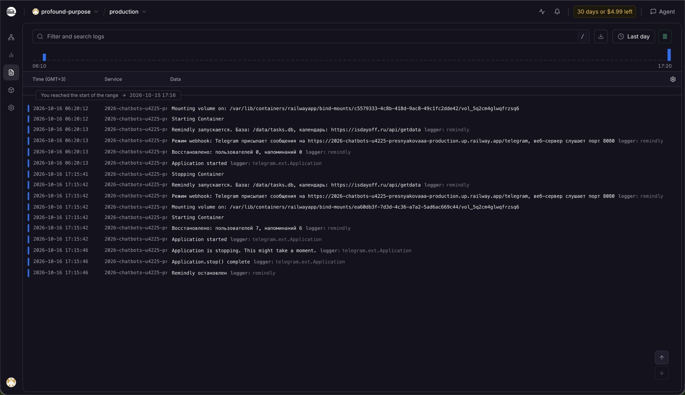
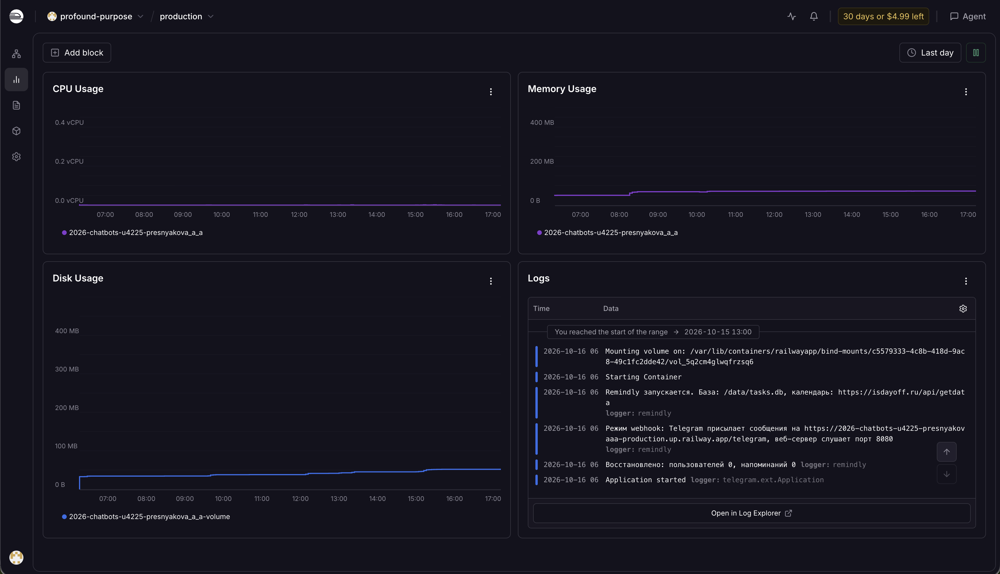
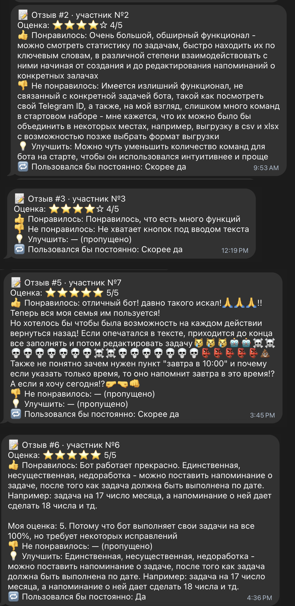
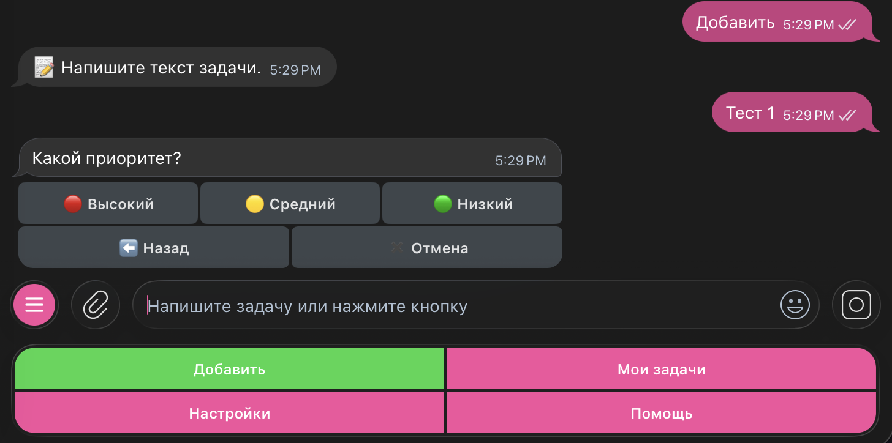
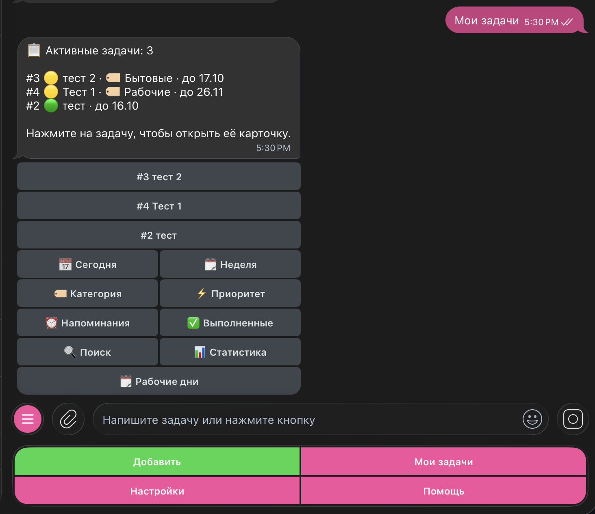
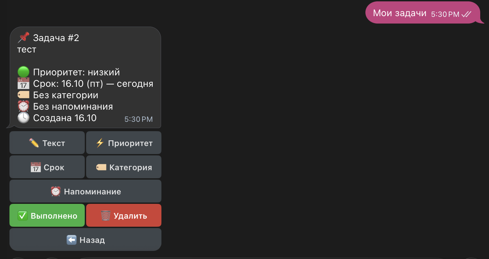
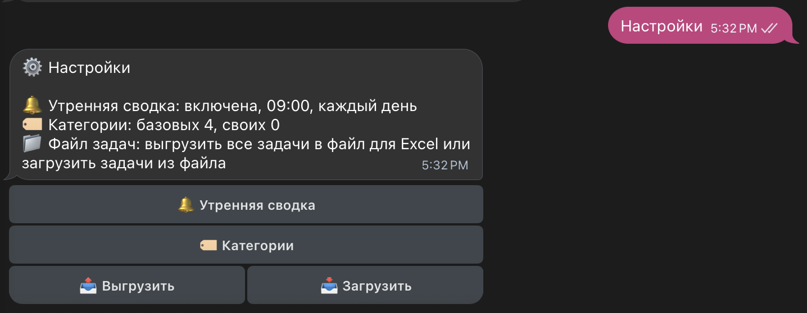
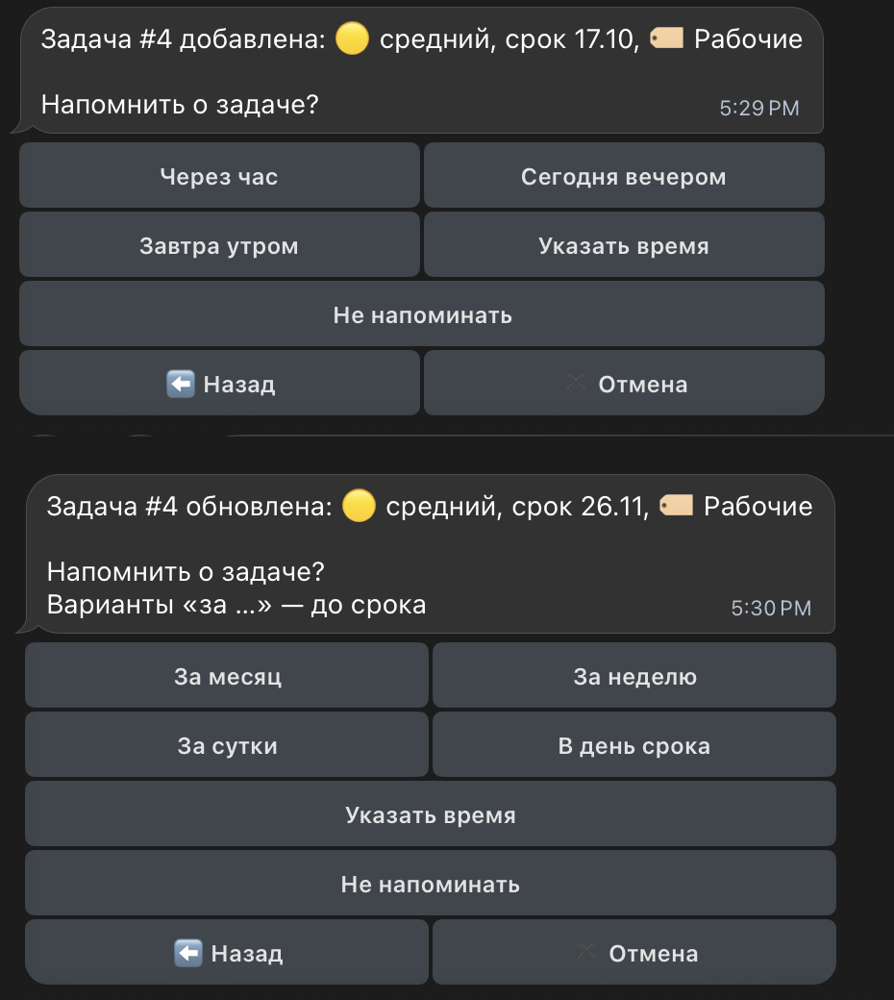

University: [ITMO University](https://itmo.ru/ru/)  
Faculty: [FICT](https://fict.itmo.ru)  
Course: [Vibe Coding: AI-боты для бизнеса](https://github.com/itmo-ict-faculty/vibe-coding-for-business)  
Year: 2026/2027  
Group: U4225  
Author: Presnyakova Anastasia Alekseevna  
Lab: Lab3  
Date of create: 15.10.2026  
Date of finished: 16.10.2026  

# Лабораторная работа №3. Запуск бота для реального использования

**Цель работы:** развернуть Telegram-бота так, чтобы им пользовались реальные люди, собрать обратную связь и улучшить бота по её результатам.

## 1. Описание деплоя

| Параметр | Значение |
|---|---|
| Бот | Remindly, [@itmoftmi_paa_bot](https://t.me/itmoftmi_paa_bot) |
| Способ деплоя | облачный хостинг [Railway](https://railway.com), код из GitHub-репозитория |
| Тариф | Trial (пробный период) |

### Выбор способа

Выбран облачный хостинг Railway. Код загружается из GitHub-репозитория курса, после каждого изменения в папке бота Railway пересобирает его автоматически. Пробного периода достаточно для тестирования и сбора отзывов.

## 2. Процесс деплоя

### Подготовка бота

Код бота подготовлен к деплою с помощью Claude Code по промпту:

```text
Подготовь бота в папке lab3/bot к размещению на Railway так, как описано в лабораторной: Railway берёт код из моего GitHub-репозитория (папка lab3/bot), токен задаётся переменной BOT_TOKEN в настройках Railway, Telegram присылает сообщения боту через webhook. Функционал не меняй.
- На Railway бот работает через webhook, на моём компьютере как раньше, без webhook. Адрес для webhook бот берёт из переменных.
- Добавь Procfile с командой запуска бота.
- База должна храниться на подключаемом диске Railway (volume), чтобы задачи не пропадали при обновлении бота.
- Логи пишутся в консоль, чтобы их было видно в панели Railway.
- Сверься с документацией docs.railway.com и python-telegram-bot.
- В README.md добавь раздел "Размещение на Railway": что настроить в Railway и какие переменные задать.
```

Что изменилось в боте:

- на сервере бот получает сообщения через webhook, на компьютере работает как раньше;
- добавлен `Procfile` с командой запуска;
- база хранится на подключаемом диске `/data`;
- логи пишутся в консоль и доступны в панели Railway;
- токен и другие настройки задаются переменными окружения, `.env` в репозиторий не попадает.

Содержимое `Procfile`:

```text
web: python bot.py
```

### Развёртывание на Railway

Загрузка кода и настройка Railway выполнены вручную:

1. Папка `lab3/bot` загружена в GitHub-репозиторий без `.env` и базы.
2. В Railway создан проект: New Project, Deploy from GitHub repo, репозиторий `2026-chatbots-u4225-presnyakova_a_a`.
3. В настройках сервиса указана папка бота (Root Directory `/lab3/bot`) и создан адрес сервиса (Generate Domain).
4. Заданы переменные: `BOT_TOKEN` (токен бота), `ADMIN_ID` (Telegram ID администратора), `PORT=8080` (порт веб-сервера для webhook).
5. К сервису подключён диск с путём `/data`.
6. Выполнен деплой, проверены логи сборки (Build Logs) и работы (Deploy Logs).
7. В логах проверено, что бот запустился в режиме webhook и база находится на диске `/data`.
8. Проверены основные функции бота в Telegram.



### Тестирование стабильности

| Проверка | Результат |
|---|---|
| бот проработал 11 часов без перезапусков, память не растёт | выполнено: 16.10.2026 с 06:20 до 17:15 ошибок в логах нет, потребление памяти стабильное |
| ежедневная сводка пришла | выполнено |
| напоминание пришло вовремя | выполнено |
| после обновления бота задачи и напоминания на месте | выполнено: после обновления 16.10.2026 в 17:15 в логе "Восстановлено: пользователей 7, напоминаний 6" |

За сутки потребление памяти не росло, процессор почти не загружен, размер базы на диске увеличивается по мере добавления задач.



### Проблемы и решения

Проблем при деплое не возникло.

## 3. Сбор обратной связи

Для сбора отзывов в бот с помощью Claude Code добавлены опрос `/feedback` и обезличенная статистика использования. Промпт:

```text
Улучши моего Telegram-бота Remindly в папке lab3/bot (это копия бота из lab2). Всё, что бот уже умеет, должно работать как раньше. Бота будут тестировать несколько реальных пользователей, мне нужно собрать их отзывы и понять, как они пользуются ботом.

1. Отзывы
- /feedback: короткий опрос: оценка от 1 до 5 (кнопки), что понравилось, что не понравилось, что улучшить, стали бы пользоваться ботом постоянно (кнопки "Да", "Скорее да", "Нет"). Текстовые вопросы можно пропустить.
- Через 2 дня после начала использования бот один раз сам предлагает оставить отзыв.
- Новый отзыв сразу приходит мне.
- Текстом: "отзыв".

2. Статистика для меня
- Команда /admin доступна только мне (мой Telegram ID указан в .env): сколько пользователей, сколько активных за неделю, сколько задач создано и выполнено, какие команды используют чаще всего, средняя оценка. Отдельно выгрузка всех отзывов файлом для Excel.
- Тексты задач пользователей мне не показывать.
- В приветствие добавить строку, что бот учебный и собирает обезличенную статистику использования.

Требования:
- Сохранить существующий функционал
- Код должен быть простым и хорошо прокомментированным
- Добавить обработку ошибок
- Обновить /help и README.md
```

Опрос из пяти вопросов: оценка от 1 до 5, что понравилось, что не понравилось, что улучшить, стал бы пользователь пользоваться ботом постоянно. Через 2 дня после начала использования бот сам предлагает пройти опрос. Тексты задач в статистику не попадают.

Для тестировщиков создана группа в Telegram. Приглашение получили 6 человек, отзыв оставили 4.

### Статистика использования

| Показатель | Значение |
|---|---|
| Пользователей всего | 7, включая автора |
| Активных за 7 дней | 7, включая автора |
| Самые частые команды | /add; /list; /start |
| Отзывов / средняя оценка | 4 / 4,5 |

### Отзывы

| № | Дата | Оценка | Что понравилось | Что не понравилось | Что улучшить | Стал бы пользоваться |
|---|---|---|---|---|---|---|
| 1 | 16.10.2026 | 4 | большой функционал: статистика по задачам, поиск по ключевым словам, работа с задачей от создания до редактирования напоминаний | есть функции, не связанные с задачей бота (например, просмотр Telegram ID); слишком много команд в стартовом наборе; выгрузку и загрузку можно объединить | уменьшить количество команд на старте, чтобы бот был проще и понятнее | скорее да |
| 2 | 16.10.2026 | 4 | много функций | не хватает кнопок под полем ввода текста | пропущено | скорее да |
| 3 | 16.10.2026 | 5 | отличный бот; хотелось бы на каждом шаге иметь возможность вернуться назад: при опечатке приходится заполнять задачу до конца и потом редактировать; непонятно, зачем нужен вариант "завтра в 10:00" и почему при указании только времени напоминание ставится на завтра | пропущено | пропущено | скорее да |
| 4 | 16.10.2026 | 5 | "бот работает прекрасно", "выполняет свои задачи на все 100%" | пропущено | можно поставить напоминание позже срока задачи: например, срок 17-го числа, а напоминание 18-го | да |

Тестировщик 3 написал замечания в поле "Что понравилось", поля "Не понравилось" и "Улучшить" пропустил.



## 4. Анализ обратной связи

### Что понравилось

- Широкий набор функций отметили два тестировщика, ещё двое оценили бота в целом: "отличный бот", "работает прекрасно".
- Отдельно названы статистика по задачам, поиск по ключевым словам и редактирование напоминаний.
- На вопрос, стали бы пользоваться ботом постоянно, один тестировщик ответил "да", трое "скорее да". Средняя оценка 4,5 из 5.

### Главные проблемы и приоритеты

| Замечание | Сколько человек упомянули | Приоритет | Решение |
|---|---|---|---|
| Слишком много команд, не хватает кнопок под полем ввода | 2 | высокий | кнопки под полем ввода; карточка задачи и разделы "Мои задачи" и "Настройки" вместо отдельных команд; в меню 5 команд вместо 21 |
| Нельзя вернуться на предыдущий шаг при добавлении задачи | 1 | высокий | кнопка "Назад" на каждом шаге добавления |
| Варианты напоминания не учитывают срок: можно выбрать напоминание позже срока, непонятно, зачем нужен вариант "завтра в 10:00" | 2 | средний | кнопки предлагают варианты в зависимости от срока, только в будущем и не позже срока; любое время можно указать вручную |
| Непонятно, когда сработает напоминание, если указано только время | 1 | средний | бот прямо пишет дату напоминания |
| Команды, не связанные с задачей бота (`/myid`) | 1 | средний | `/myid` убрана из меню и `/help` |
| Выгрузку и загрузку файла можно объединить | 1 | низкий | пункт "Файл задач" в настройках |

Высокий приоритет получили замечания об основном сценарии: добавлении задачи и навигации по боту. Их отметили два из четырёх тестировщиков.

## 5. Улучшения

### Промпт

```text
По отзывам тестировщиков бот кажется сложным: слишком много команд и мало кнопок. Упрости бота в папке lab3/bot. Всё, что бот умеет, должно остаться, меняется только то, как до этого добраться.

1. Кнопки под полем ввода
- Постоянные кнопки: "Добавить", "Мои задачи", "Настройки", "Помощь".
- Раскрась кнопки, где это помогает: "Добавить" и "Выполнено" зелёные, "Удалить" красная, остальные основные синие

2. Карточка задачи
- Задачу можно открыть из списка. В карточке видно всё о задаче и есть кнопки: изменить текст, приоритет, срок, категорию, напоминание, "Выполнено", "Удалить", "Назад".
- Карточка заменяет команды /edit, /done, /remind, /delete.

3. Раздел "Мои задачи"
- Список с фильтрами кнопками: на сегодня, на неделю, по категории, по приоритету, с напоминаниями, выполненные.
- Там же поиск, статистика и рабочие дни до конца месяца.
- Раздел заменяет команды /list, /today, /reminders, /history, /find, /stats, /workdays.

4. Раздел "Настройки"
- Утренняя сводка, категории и файл задач (выгрузить или загрузить) в одном месте.
- Раздел заменяет команды /digest, /categories, /export, /import.

5. Меню команд
- В меню оставь только /add, /list, /settings, /feedback, /help и /admin для меня.
- /myid и /cancel убери из меню и из /help. Вместо /cancel в диалогах кнопки "Назад" и "Отмена".
- Если кто-то напишет старую команду или текстовую команду вроде "сделано 3", она работает как раньше, но в меню и /help её нет.

6. Добавление задачи
- На каждом шаге кнопка "Назад": возвращает на предыдущий шаг, уже введённое сохраняется.

7. Варианты напоминания
- Кнопки предлагают только разумные варианты: в будущем и не позже срока задачи. Не должно быть такого, что срок завтра, а бот предлагает напомнить через неделю.
- Варианты зависят от того, сколько осталось до срока, например:
  - без срока: через час, сегодня вечером, завтра утром, через неделю;
  - срок сегодня: через час, через 3 часа, сегодня вечером;
  - срок завтра: через час, сегодня вечером, завтра утром;
  - срок через несколько дней: завтра утром, за сутки, в день срока утром;
  - срок через неделю и больше: за неделю, за сутки, в день срока; если до срока больше месяца, ещё за месяц.
  Прошедшие варианты не показываются, одинаковые не повторяются.
- Кнопка "Указать время" есть всегда: вручную можно поставить любое время, в том числе после срока.
- Если указано только время, а сегодня оно уже прошло, бот прямо пишет, что напомнит завтра, и показывает дату.

Обнови /help и README.md. Коротко перечисли, что сделано.
```

### Что изменено и как это помогло

| Улучшение | Чьё замечание | Результат после изменения |
|---|---|---|
| Кнопки под полем ввода, в меню 5 команд вместо 21 | 1, 2 | основные действия доступны одним нажатием |
| Карточка задачи и разделы "Мои задачи" и "Настройки" вместо отдельных команд | 1 | изменение, выполнение, напоминание и удаление собраны в карточке задачи; выгрузка и загрузка файла объединены в настройках |
| Кнопка "Назад" на каждом шаге добавления задачи | 3 | при опечатке можно вернуться на предыдущий шаг, не заполняя задачу до конца |
| Варианты напоминания зависят от срока | 3, 4 | бот не предлагает напоминание позже срока; любое время можно указать вручную |












## 6. Выводы

### Что получилось

- Бот развёрнут на Railway и работает круглосуточно. Новые версии загружаются через GitHub.
- Бота протестировали реальные пользователи, средняя оценка 4,5 из 5.
- По отзывам упрощён интерфейс: в меню 5 команд вместо 21, основные действия вынесены на кнопки, появились карточка задачи и кнопка "Назад", варианты напоминания учитывают срок задачи.

### Что можно улучшить дальше

- Собрать отзывы за более долгий срок. За первые дни тестировщики оценили в основном интерфейс. Напоминания и утреннюю сводку можно оценить только при ежедневном использовании.
- Не учитывать действия администратора в статистике `/admin` и добавить удаление тестовых отзывов.
- До окончания пробного периода Railway перевести бота на другой хостинг, чтобы он продолжал работать.

### Чему научилась

Разворачивать бота на облачном хостинге, собирать и обрабатывать обратную связь.
